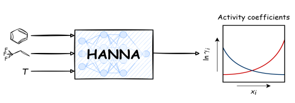
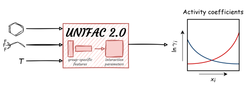
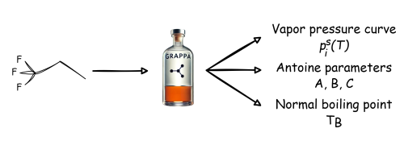
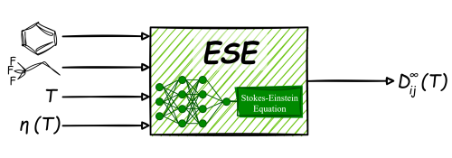
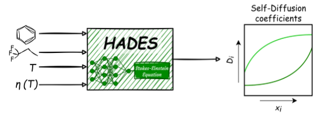

```@meta
CollapsedDocStrings = true
```

# [Models](@id models_page)

## HANNA



HANNA is a hard-constraint neural network model for the excess Gibbs energy ``g^E`` that predicts activity coefficients in a strictly thermodynamically consistent manner [specht_hanna_2024, hoffmann_thermodynamically_2026](@cite).
It only requires the SMILES of the components and the temperature as input.
The model satisfies thermodynamic boundary conditions by construction, ensuring consistency of the predicted activity coefficients.

Two versions of the model are available:
- **`ogHANNA`**: The original version (HANNA v1.0.0), trained on binary VLE data (up to 10 bar) and limiting activity coefficients from the Dortmund Data Bank [specht_hanna_2024](@cite). This version is limited to binary mixtures.
- **`HANNA`** (alias `multHANNA`): The latest version, trained on VLE and LLE data, and applicable to multi-component mixtures [hoffmann_thermodynamically_2026](@cite).

```@docs
MLThermoProperties.ogHANNA
MLThermoProperties.multHANNA
```

## mod. UNIFAC 2.0 and UNIFAC 2.0



UNIFAC 2.0 and mod. UNIFAC 2.0 are enhanced versions of the classical group-contribution methods UNIFAC and mod. UNIFAC (Dortmund), respectively.
Missing interaction parameters are predicted using matrix completion, which significantly extends the applicability of the methods and leads to a higher prediction accuracy compared to the original versions [hayer_advancing_2025, hayer_modified_2025](@cite).
The methods for [UNIFAC 2.0](https://clapeyronthermo.github.io/Clapeyron.jl/stable/eos/activity/#Clapeyron.ogUNIFAC2) and [mod. UNIFAC 2.0](https://clapeyronthermo.github.io/Clapeyron.jl/stable/eos/activity/#Clapeyron.UNIFAC2) are described in the `Clapeyron.jl` documentation.

## GRAPPA



GRAPPA is a graph neural network model for predicting vapor pressures and boiling points of pure components [hoffmann_grappahybrid_2025](@cite).
The model predicts the parameters ``A``, ``B``, and ``C`` of the Antoine equation:

```math
\ln(p^s / \text{kPa}) = A - \frac{B}{T / \text{K} + C}
```

On model construction, the Antoine parameters are predicted and a [`SaturationModel`](https://clapeyronthermo.github.io/Clapeyron.jl/stable/eos/correlations/#Clapeyron.SaturationModel) is automatically created, which enables the calculation of the vapor pressure via [`saturation_pressure`](https://clapeyronthermo.github.io/Clapeyron.jl/stable/properties/single/#Clapeyron.saturation_pressure) for a given temperature.

```@docs
MLThermoProperties.GRAPPA
```

## COGNAC

COGNAC (local-COmposition Graph Neural network for the prediction of Activity Coefficients) predicts the group parameters of a UNIFAC model with a graph neural network instead of taking them from a fitted table [hoffmann_learning_2026](@cite).
In contrast to group-based UNIFAC, COGNAC treats every atom as its own group.
Since the group table depends on the mixture, it is predicted at model construction and is valid only for that set of components.
Symmetry-equivalent atoms of a molecule (e.g., the two hydrogens of water, the six carbons of benzene) form one group counted by ``\nu_{ki}``, just as mod. UNIFAC counts, e.g., "2 × CH3".

Two variants of COGNAC are available: `COGNACexp` (or just `COGNAC`) and `COGNACimp`.
Both variants are based on mod. UNIFAC (Dortmund): the network predicts ``R_a`` and ``Q_a`` per atom and the three interaction-polynomial coefficients ``a_{ab}``, ``b_{ab}``, and ``c_{ab}`` per atom pair. They differ only in the residual term:

- `COGNACexp` (alias `COGNAC`) evaluates the group activity coefficients from the closed-form mod. UNIFAC expression.

- `COGNACimp` evaluates them as the solution of the COSMOSPACE self-consistency condition, which is more accurate at infinite dilution but needs to solve an implicit equation internally.

```@docs
MLThermoProperties.COGNACexp
MLThermoProperties.COGNACimp
```

## ESE



ESE is a hybrid model for predicting binary diffusion coefficients at infinite dilution [wagner_hybrid_2026](@cite).
The model incorporates the Stokes-Einstein equation and ensures a physically consistent temperature dependence of the predicted diffusion coefficients.
It only requires the SMILES of the solute and solvent as input, together with a viscosity model for the solvent.

```@docs
MLThermoProperties.ESE
```

## HADES



HADES (Hybrid Architecture for consistent Diffusion-coefficient Estimation across Solvents) is a hybrid model for predicting self-diffusion coefficients in liquid mixtures with an arbitrary number of components at any composition and temperature [wagner_comp_2026](@cite).
It extends the ESE model by a deep-set neural network, which allows a unified description of diffusion at infinite dilution in pure and mixed solvents as well as self-diffusion at finite concentrations.
Like ESE, the model incorporates the Stokes-Einstein equation, which ensures a physically consistent temperature dependence of the predicted diffusion coefficients.
It only requires the SMILES of all components as input, together with viscosity models for the pure components.

```@docs
MLThermoProperties.HADES
```

## Other Models

### ChemBERTa.jl

The package [`ChemBERTa.jl`](https://github.com/se-schmitt/MLThermoProperties.jl/tree/main/lib/ChemBERTa) contains encoder language models from the ChemBERTa model family. 
It is an registered package and can be used independently of `MLThermoProperties.jl`.

```@docs
ChemBERTa.ChemBERTaModel
```